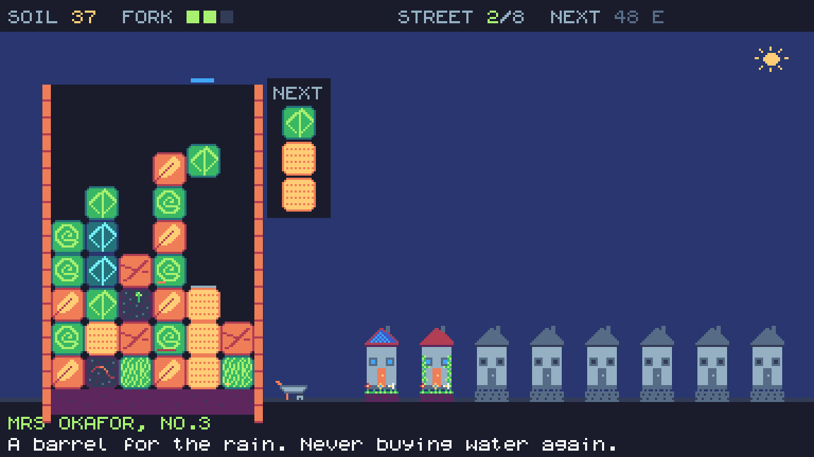
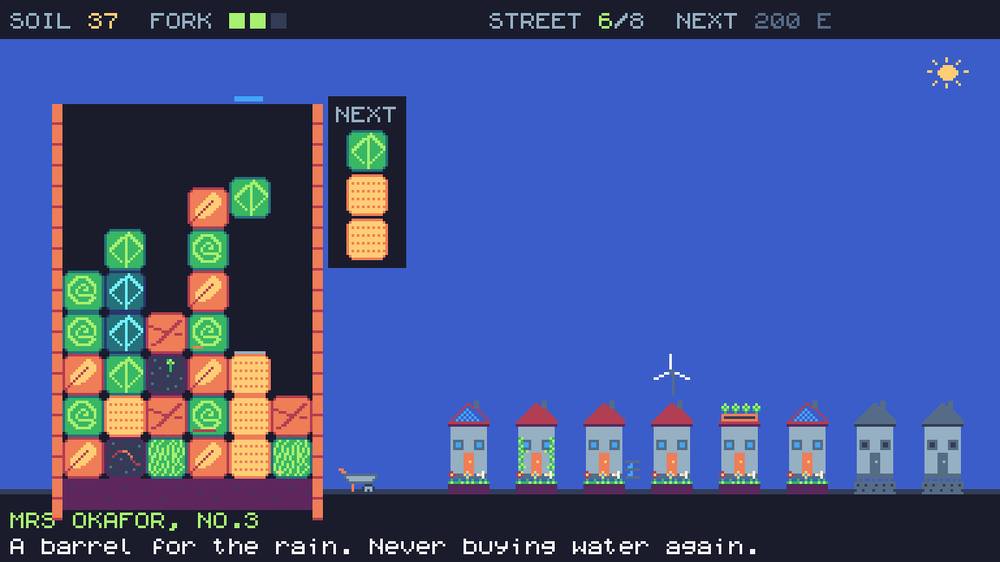
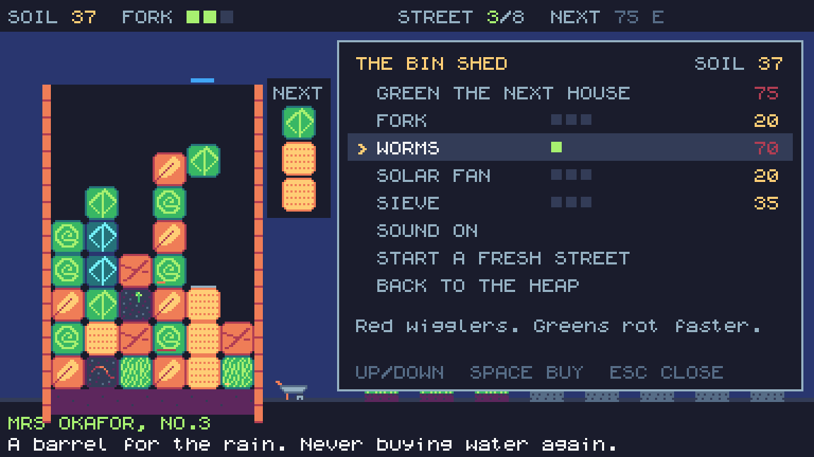
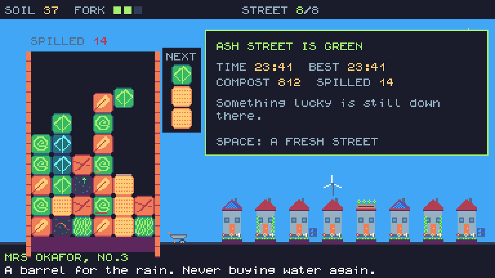

# Composters of SPLORR!!: a compost bin in a day (November 16, 2026)

Draft, not posted. If it is ever posted on itch.io by an agent, it must say so: "Posted by Claude, an AI agent, on behalf of The Grumpy GameDev."

Made for Jamference: AI Game Jam Hack 4 (theme Solarpunk, restriction Hidden Lucky Cat). Four pitches went in: a block microgrid, a rooftop garden, a cargo bike, and the street's compost bin. The bin won.

The bin is a cross-section, six columns by nine. Scraps fall in one at a time. Greens rot where they touch browns; greens packed together go slimy; browns on their own stay cold. The fork turns a column, bottom to top, and airs it. Compost sinks and drops out of the hatch as soil.

Soil greens the street, house by house: solar roofs, vines, rain barrels, a wind turbine, a rooftop farm. Each house brings a neighbour, more scraps and a different mix. The smog lifts as it goes.

The bin shed sells the next house and four upgrades: a sturdier fork, worms, a solar fan and a sieve.

There is a lucky cat. We are not saying where. Old Mo might.

How it was made: TheGrumpyGameDev chose the idea and made the design calls; Claude Code wrote the code and tests, drew the pictures in the Anvil, made the blips, wrote the neighbours, and ran a playtest bot. The bot found that a heap full of cold browns could lock up for good, so scraps that touch nothing useful now break down on their own, slowly; and it tuned the prices so a street takes 20 to 30 minutes.
